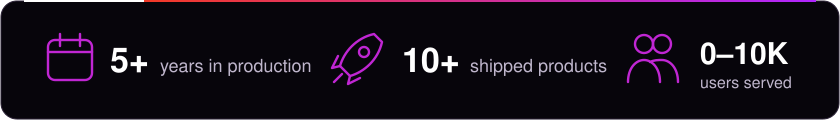

<p align="center">
  
</p>

<table>
  <tr>
    <td colspan="2" align="center">
      <a href="https://www.linkedin.com/in/serh-luts-fullstack-dev"></a>&nbsp;
      <a href="mailto:sergiyluciv@ukr.net"></a>&nbsp;
      <a href="./resume.pdf"></a>&nbsp;
      
    </td>
  </tr>
  <tr>
    <td colspan="2">
      <h3>&gt; whoami_ 🛰️</h3>
    </td>
  </tr>
  <tr>
    <td width="68%" valign="top">
      <br />
      <b>Senior Full-Stack Engineer</b> (Lviv, Ukraine → remote, EU / US)
      <br /><br />
      I turn specs into products that people actually open every day. Five years of shipping React / Next.js frontends and Node.js backends for <b>fintech</b>, <b>healthcare</b> and <b>AI-driven SaaS</b>, plus React Native apps that land on iOS and Android from one codebase.
      <br /><br />
      I care about the boring numbers that make users happy: pages that went from <b>~3s to under 1s</b>, APIs that got <b>30% faster</b> after a round of query tuning and Redis, deploys that dropped from hours to <b>under 15 minutes</b>.
      <br /><br />
      Right now my orbit is <b>TypeScript</b>, <b>NestJS</b>, <b>PostgreSQL</b>, <b>AWS</b>, real-time features over WebSockets and wiring <b>OpenAI</b> into products so they do something useful, not just something shiny.
      <br /><br />
    </td>
    <td width="32%" align="center" valign="middle">
      
    </td>
  </tr>
  <tr>
    <td colspan="2">
      
    </td>
  </tr>
</table>

<p align="center">
  
</p>

<h3>&gt; stack.config.ts</h3>

```ts
export const stack = {
  frontend:  ["React", "Next.js", "TypeScript", "Tailwind", "Redux / Zustand"],
  mobile:    ["React Native", "Expo"],
  backend:   ["Node.js", "NestJS", "Express", "Fastify", "GraphQL", "REST"],
  data:      ["PostgreSQL", "MongoDB", "Redis"],
  cloud:     ["AWS (ECS, CodePipeline)", "Docker", "GitHub Actions"],
  wiredInto: ["Stripe", "Twilio", "Google Maps", "OpenAI", "Firebase Auth", "WebSockets"],
} as const;
```

<p align="center">
  
</p>

<h3>&gt; changelog</h3>

```diff
+ 2025 → now   Senior Full-Stack   enterprise SaaS for EU/US · load time 3s → <1s · API latency −30% · OpenAI features
+ 2022 → 2024  Middle Full-Stack   fintech & healthcare UIs · render perf +25% · 5+ third-party integrations
+ 2021 → 2022  Junior Full-Stack   React component libraries · Node/Express APIs · Git workflow the team adopted
```

<p align="center">
  
  <br />
  <sub>// shipping something right now. probably refactoring it tomorrow.</sub>
</p>
